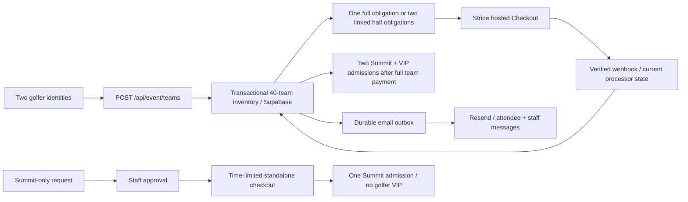

# GLOBAL Invitational implementation and operator handoff

Feature branch: `feat/invitational-registration`. Existing GitHub/Netlify hosting is preserved. No production push, hosted staging deploy, account configuration or real funds movement was performed.

## Preview and content structure

- `/invitation`: international series introduction, San Antonio feature, future-event updates and global partnership path.
- `/invitation/experiences/the-global-invitation-san-antonio-2027`: preserved canonical event URL. Hero → price/field proof → two-day overview → full/split registration → abstract venue illustration and lodging limits → golf → Summit → planned package → charity → FAQ → sponsors/vendors/questions → future editions.
- `/invitation/inquire/{summit,sponsor,vendor,general,future}`: five separately labeled, server-validated lead paths.
- `/invitation/registration/pay`: restricted email-link entry, with capability tokens in the URL fragment to avoid normal access-log/referrer leakage.
- `/invitation/registration/return`: neutral return screen; never treats a redirect as payment confirmation.
- `/invitation/event-terms`: intentionally pending approval; no invented cancellation policy.
- 301 redirects: old membership route → series; old apply route → event choices. Unrelated GSA/GDA/GCN routes remain intact.

Mobile uses stacked day cards, shallow anchor navigation, native FAQ disclosure and a compact sticky registration bar. Existing navy, ivory, gold and typography are preserved. The shared homepage's Invitational feature and entry CTAs were updated without redesigning unrelated initiatives.

## GLOBAL Signature design update

Owner selected a balance of private-club luxury and modern finance, then authorized implementation. The series and edition pages now use full-bleed photography, editorial serif typography, a warm golf chapter, a navy Summit chapter, horizontal venue gallery with native-dialog lightbox, a unified team-experience panel, compact sticky registration shortcuts and a quieter registration preview while sales remain closed. The homepage's Invitational imagery and date were updated to match; unrelated initiative content is preserved.

The owner confirmed written commercial-use permission for Briggs Ranch/Dormie photography in chat on November 17, 2026. Seven photographs were downloaded from the official gallery, resized/compressed locally to WebP, and credited in `public/images/CREDITS.md`. No hotlinks or generated venue imagery. The existing licensed conference image is explicitly labeled editorial and does not imply a confirmed Summit venue. Photography permission does not open checkout or approve charity, hospitality, lodging or payment terms.

## Architecture

Tables: `event_teams`, `event_payments`, `event_stripe_events`, `event_admissions`, `event_leads`, `event_summit_orders`, `event_outbox`. All RLS-protected; no public policies. Only server-side service role can call the migration's functions. Do not expose the service key to the browser.

Inventory holds count immediately, with an advisory transaction lock across reservations and payment application. Payment obligations and webhook IDs are unique. Exactly two admissions are inserted only once on a fully paid golf team. A Summit-only order has its own single admission and cannot consume a team slot. Refund/dispute review suspends admission without automatically reselling inventory.

The backend checks session amount, currency, kind, team, obligation, session ID and current Stripe payment state. It also checks current charge/refund state before fulfillment to avoid confirming a refunded/disputed payment after an out-of-order success notification. Webhook handling remains available while sales are closed so existing payments can reconcile.

## Setup order

1. Provision staging Supabase; apply `supabase/event-registration.sql` once.
2. Configure `.env.event.example` variable names in Netlify staging secrets. Generate long random `EVENT_LINK_SECRET` and `EVENT_ADMIN_SECRET` (at least 32 characters). Do not rotate payment-link signing secrets mid-sale without a migration plan.
3. Configure `EVENT_PUBLIC_ORIGIN` to the exact staging origin, `NEXT_PUBLIC_SITE_URL` to the intended canonical URL, and set `EVENT_CHECKOUT_MODE=test`. `CONTEXT=production` explicitly rejects test checkout. Staging pages must remain noindex.
4. Register `/api/event/stripe` in the Stripe test account. Subscribe to `checkout.session.completed`, `checkout.session.async_payment_succeeded`, `checkout.session.async_payment_failed`, `checkout.session.expired`, payment-intent processing/success/failure, `charge.refunded`, `charge.dispute.created`, refund created/updated/failed. Configure that endpoint's webhook signing secret.
5. Set `EVENT_POLICY_VERSION` to the reviewed test policy version. Configure Resend and the monitored event inbox. Verify mail-worker delivery, then set `EVENT_MAIL_WORKER_VERIFIED=true`; checkout and online inquiries fail closed without it. The owner supplied `info@globalaccess.live` for public contact; it is displayed as a fallback without claiming monitored delivery.
6. Invoke admin maintenance to send mail in staging; Netlify scheduled functions normally run on published deploys. Test the deployed five-minute schedule separately.
7. Complete actual processor test orders and owner review; clear LAUNCH_BLOCKERS before live enablement.

## Operator API

`POST /api/event/admin` requires `Authorization: Bearer <EVENT_ADMIN_SECRET>` and JSON. Keep credentials in environment or a trusted operator client, never URLs or source files.

Actions:

- `{ "action": "export" }`: bounded teams, obligations, admissions, Summit orders, categorized leads and unsent-mail diagnostics. Contains personal information; handle as private operational data.
- `{ "action": "maintenance" }`: reconcile processor sessions, release only safe unpaid expired holds, hold partially paid teams for review, claim and send up to 20 outbox messages. May be retried safely. Provider success followed by a database failure is retried with a stable email idempotency key.
- `{ "action": "approve_summit", "leadId": "<UUID>" }`: approve only a stored Summit request, queue a restricted 24-hour payment invitation. Works in configured test mode; live requires approved standalone pricing and all live gates. Retry reuses the same order.

No public admin dashboard or raw card fields. No automatic sponsorship payment collection. No extra golf upgrade charges. Staff handles reviews/refunds through controlled processor/database operations after the applicable policy and approval; release/reinstatement must be reconciled, never a blind table edit.

## Validation and limits

`npm test` executes ten tests against the actual migration in embedded PostgreSQL: full/split/processing, duplicates, 40 holds, mismatches, refunds, permissions, lead/outbox atomicity, Summit approval and admission idempotency, safe hold release. All data uses `.test` email domains. `node scripts/smoke-event.mjs` checks local HTTP pages, heading structure, legacy redirects, absent-credential failure states, protected admin access and public package copy.

`npm run typecheck`, `npm run lint`, `npm run build`. Build uses supported Webpack and the documented Tailwind PostCSS adapter because the original Turbopack loader child process fails on this Windows host. Existing Google Fonts require build-time network access. The Next.js patch was updated to 16.4.6 after audit.

No credentials were available for real Stripe, Resend, Supabase deployment, Netlify staging, hosted Lighthouse or cross-device hosted checkout. Local rendering and SQL tests are evidence for the implemented code, not proof of production readiness.

## Suggested release order

1. Private staging: closed checkout, content/wireframe and licensed imagery approval.
2. Staging test mode: real Stripe test payments, inbox delivery, recovery and staff export.
3. Approved production informational pages and monitored inquiries; checkout remains closed.
4. Approved live golf checkout, then independently approved standalone Summit checkout.
5. Later: crypto rails, Luma/check-in, custom lodging portal, sponsor self-checkout and future-city catalog.

## Rollback

Set `EVENT_CHECKOUT_MODE=closed` and `EVENT_LEADS_ENABLED=false`, redeploy, and retain webhook and maintenance processing for in-flight payments. Never drop financial records or stop reconciliation during rollback. Restore the prior Netlify deploy for public pages only after ensuring the current payment endpoints continue on a stable supported deployment. Resolve processing/partial payments with the organizer before releasing holds. Revert the feature branch through normal Git review; do not reset production data.
